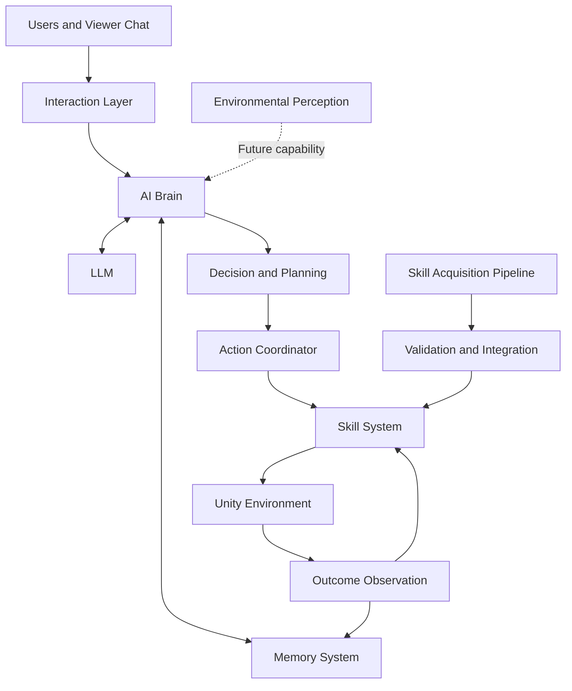

# RoomAgent — Product Vision & Ideas

> **Building autonomous AI characters that can reason, act, learn, and evolve in virtual worlds.**

## 1. Vision

RoomAgent is a personal research and development project focused on building autonomous AI characters that exist and operate inside interactive 3D environments.

Instead of limiting AI characters to text-based conversations, RoomAgent aims to connect language-based intelligence with embodied behavior. An AI character should be able to understand interactions, maintain relevant context, make decisions, execute actions, observe outcomes, and progressively expand its capabilities.

The long-term vision is to create a virtual character that behaves less like a predefined game NPC and more like an autonomous digital entity with its own capabilities, experiences, and ongoing interactions with the world.

## 2. Core Idea

The central idea behind RoomAgent is to combine several capabilities into a unified AI character system.

### 2.1. Context-Aware Intelligence

The character should reason about more than the latest user message.

Relevant context may include:
- Current environment state.
- Recent conversations and interaction history.
- Available actions and skills.
- Previous execution outcomes.
- Current activity and interaction priorities.

The AI Brain uses this context to determine what the character should do next.

### 2.2. Embodied Action

An AI character should be able to translate decisions into observable behavior.

Actions may include:
- Moving to a location.
- Turning toward a target.
- Performing an animation.
- Interacting with an object.
- Using a smartphone or camera.
- Responding to viewers through a livestream interaction.

Unity provides the environment in which supported actions are executed and observed.

### 2.3. Memory and Experience

The system should preserve useful information across interactions instead of treating every interaction as an isolated event.

Potential memory categories include:
- **Interaction Memory:** Previous conversations and user requests.
- **Contextual Memory:** Relevant environmental and activity context.
- **Skill Memory:** Available capabilities and execution requirements.
- **Outcome Memory:** Results of previous actions and their evaluation.

Memory should improve the relevance of future decisions without allowing outdated or unreliable observations to become unquestioned facts.

### 2.4. Autonomous Skill Acquisition

The character should eventually be able to expand its action repertoire beyond a fixed collection of manually authored behaviors.

A potential workflow is:

1. Identify a capability gap or requested behavior.
2. Determine whether an existing skill can satisfy the requirement.
3. Acquire or generate a candidate skill or motion artifact.
4. Validate its structure, compatibility, and execution requirements.
5. Integrate the validated capability into the skill system.
6. Execute the skill under controlled conditions.
7. Observe the outcome and evaluate whether the capability is reusable.

The key idea is not simply to generate more animations, but to turn candidate behaviors into validated, reusable capabilities.

Autonomous acquisition must remain separate from unrestricted execution. New skills should pass appropriate validation before becoming available to the runtime.

## 3. Product Concept: An Autonomous AI Livestream Character

One of the main applications of RoomAgent is an AI character that can interact with viewers through livestream chat while existing in a persistent 3D environment.

### Intended Experience

A viewer sends a message. The character interprets the request, considers its current context and capabilities, chooses an appropriate response or action, and executes that action in the virtual world.

For example:

1. A viewer requests that the character dance.
2. The Brain interprets the message and evaluates available skills.
3. The planner selects a compatible dance skill.
4. The action coordinator dispatches the skill to Unity.
5. The character performs the animation.
6. The system records the execution outcome for evaluation and future reuse.

The same architecture can support conversational responses, movement requests, object interactions, and other supported behaviors.

### Livestream Interaction Goals

- Receive and process viewer messages.
- Maintain conversational context.
- Prioritize and manage incoming requests.
- Select appropriate responses or executable skills.
- Perform actions that viewers can observe.
- Integrate a smartphone camera into a virtual livestream setup.
- Support future expansion into more adaptive and autonomous character behavior.

The goal is to make the character's behavior observable and interactive, rather than presenting it only as a chatbot with a 3D avatar.

## 4. Target Architecture

RoomAgent is designed around a separation between intelligence, coordination, and embodied execution.

### Architectural Responsibilities

**AI Brain**
- Interprets the current interaction and available context.
- Evaluates possible responses and actions.
- Produces structured action plans.
- Coordinates reasoning with memory and available capabilities.

**LLM Layer**
- Supports natural-language understanding and contextual reasoning.
- Helps produce structured plans within the system's defined constraints.
- Can use local inference to reduce reliance on external model services.

**Memory System**
- Stores relevant interaction history and contextual information.
- Makes useful past experiences available to subsequent decisions.
- Supports evaluation and reuse of prior skills.

**Skill System**
- Represents executable capabilities in a reusable form.
- Tracks skill requirements and compatibility.
- Connects action plans to supported execution procedures.

**Action Coordinator**
- Bridges high-level decisions and lower-level execution.
- Tracks execution state and completion.
- Handles failures and outcomes through explicit runtime interfaces.

**Unity Environment**
- Executes movement, animations, navigation, and supported object interactions.
- Provides observable character and environment state.
- Supplies execution feedback to the backend where supported.

**Skill Acquisition Pipeline**
- Develops candidate capabilities.
- Validates motion artifacts and execution compatibility.
- Integrates accepted skills into the reusable skill system.

These components form the target architectural direction. Individual capabilities may have different levels of implementation maturity.

## 5. Environmental Perception

A future direction is to extend RoomAgent beyond predefined or explicitly supplied environment state.

Computer Vision could allow the character or its surrounding system to identify objects, people, activities, and relevant spatial information from visual input.

Potential capabilities include:

- Real-time object detection.
- Recognition of relevant scene elements.
- Tracking object positions over time.
- Estimating spatial relationships.
- Detecting changes in the environment.
- Providing visual context for action planning.

For example, an AI character could eventually identify a nearby object, reason about its location, and select an appropriate interaction if a compatible skill exists.

Environmental perception would provide observations to the Brain; it would not independently guarantee correct reasoning or safe action execution.

## 6. Learning and Adaptation

RoomAgent aims to explore how an AI character can improve its behavior through accumulated experience and reusable capabilities.

Potential learning mechanisms include:

### Outcome-Based Evaluation

Compare the intended action with the observed execution result.

Questions include:
- Did the action execute successfully?
- Did it achieve the intended objective?
- Was the result compatible with the environment?
- Should the skill be reused, revised, or rejected?

### Skill Reuse

Prefer an existing validated capability when it satisfies the current request instead of repeatedly generating or acquiring an equivalent skill.

### Skill Expansion

Introduce additional capabilities through controlled acquisition, validation, and integration workflows.

### Experience-Guided Decisions

Use reliable historical outcomes to inform future skill selection and planning.

These mechanisms do not necessarily require training a new neural network. Memory, evaluation, planning, and skill reuse can improve system behavior independently of model-weight updates.

Reinforcement learning and other model-training approaches may be explored later if they address a demonstrated limitation.

## 7. Development Roadmap

The roadmap is organized around progressively increasing system capability rather than committing to fixed delivery dates.

### Stage 1 — Core Virtual Environment

- Establish the Unity room and character.
- Integrate navigation and animation.
- Implement smartphone and camera interactions.
- Connect Unity to the backend.

**Goal:** A functional 3D environment with controllable character behavior.

### Stage 2 — AI Interaction and Action Planning

- Integrate chat and interaction APIs.
- Connect the AI Brain to an LLM.
- Convert interactions into structured action plans.
- Connect plans to executable skills.
- Validate the end-to-end interaction loop.

**Goal:** A character that can process requests and execute supported actions.

### Stage 3 — Memory and Skill Infrastructure

- Maintain useful interaction and contextual memory.
- Organize capabilities into reusable skills.
- Track execution state and outcomes.
- Improve action coordination and failure handling.

**Goal:** More consistent decisions and more reliable skill reuse.

### Stage 4 — Autonomous Skill Acquisition

- Develop motion acquisition and artifact conversion workflows.
- Validate motion and rig compatibility.
- Integrate compatible animation artifacts into Unity.
- Register and execute accepted skills.
- Evaluate results through isolated end-to-end workflows.

**Goal:** A controlled path for extending the character's capabilities.

### Stage 5 — Real-Time Environmental Perception

- Explore Computer Vision integration.
- Detect relevant objects and scene changes.
- Convert visual observations into structured environmental state.
- Connect observations to planning and compatible skills.

**Goal:** Enable decisions based on observed environmental information.

### Stage 6 — Adaptive Autonomous Character

- Improve long-term memory and experience retrieval.
- Refine planning using execution outcomes.
- Expand the skill library.
- Explore more advanced learning methods where justified.
- Improve robustness under continuous interaction.

**Goal:** A more adaptive character that can operate with less manual intervention.

These stages describe the intended direction, not a claim that every capability has already been implemented or completed.

## 8. Engineering Principles

### Local-First AI

Prefer local LLM inference where practical, with explicit control over model selection, resource consumption, and external dependencies.

### Modular Design

Keep reasoning, memory, planning, skill management, and Unity execution as distinct responsibilities with explicit interfaces.

### Structured Decisions

Use machine-readable plans and validated action definitions rather than relying on unconstrained natural-language output for execution.

### Validated Execution

Treat a generated plan as an intention, not proof that an action succeeded. Confirm execution through observable runtime state and outcomes.

### Controlled Skill Acquisition

Separate candidate generation from compatibility validation, registration, and execution.

### Testable Development

Use automated tests, regression suites, and isolated end-to-end scenarios to verify changes before considering broader adoption.

### Incremental Complexity

Prioritize a reliable end-to-end system before introducing more advanced perception, learning, or autonomous generation capabilities.

## 9. Challenges to Explore

Several technical challenges remain important to the long-term vision:

- **LLM reliability:** Producing valid, actionable plans consistently.
- **Latency:** Keeping reasoning and action execution responsive during continuous interaction.
- **Memory quality:** Retaining useful context while avoiding irrelevant or misleading information.
- **Action grounding:** Ensuring planned actions correspond to real, supported capabilities.
- **Execution reliability:** Detecting failures and preventing the system from assuming an action succeeded.
- **Motion compatibility:** Integrating acquired motion artifacts with the target rig and runtime.
- **Perception accuracy:** Translating visual observations into reliable environmental state.
- **Resource constraints:** Balancing model quality, inference latency, and available local hardware.
- **Continuous operation:** Managing queues, interruptions, repeated requests, and recovery during extended runtime.

These challenges guide future experiments and architectural decisions.

## 10. Long-Term Vision

The long-term ambition is to create AI characters that can do more than answer questions.

A RoomAgent character should progressively gain the ability to:

- Understand its interactions and environment.
- Maintain useful memories of prior experiences.
- Select and execute appropriate actions.
- Expand its capabilities through validated skill acquisition.
- Evaluate action outcomes and reuse successful behaviors.
- Incorporate real-time environmental perception.
- Participate in persistent, interactive virtual experiences.

RoomAgent is a step toward embodied AI agents that connect language-based intelligence with observable behavior in interactive worlds.

---

*RoomAgent — From language-based reasoning to autonomous embodied behavior.*
