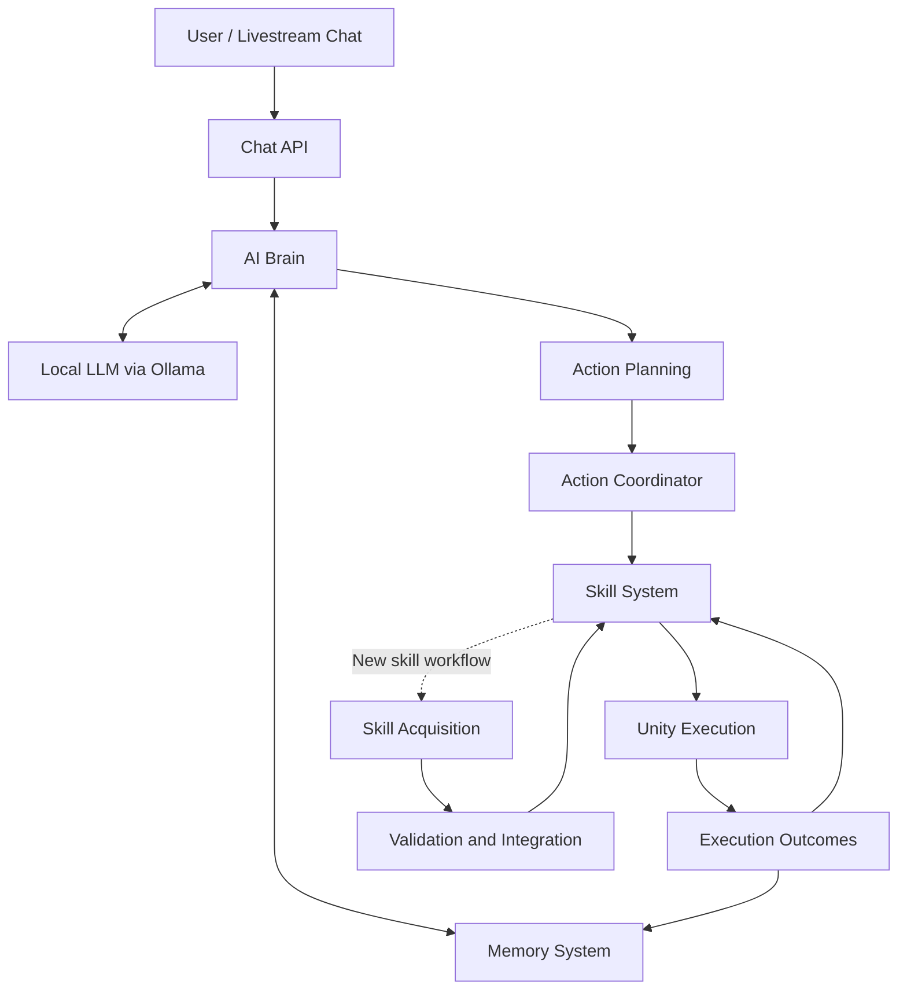
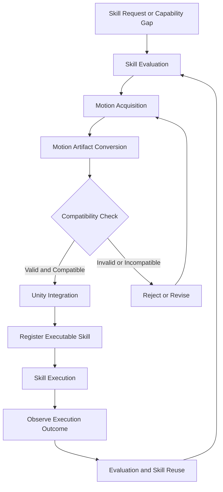

# RoomAgent — Autonomous AI NPC

**Connecting LLM reasoning with autonomous, embodied behavior in a 3D virtual world.**

RoomAgent is an autonomous AI character system that bridges large language models (LLMs), contextual memory, skill-based action execution, and a 3D Unity environment.

The project explores how an AI character can process user interactions, reason about its current context, select and execute actions, observe execution outcomes, and reuse previously acquired skills. By combining a Python-based AI backend with a Unity-based virtual environment, RoomAgent provides a foundation for developing interactive, embodied AI agents.

## Overview

RoomAgent consists of two primary components:

| Component | Responsibility |
|---|---|
| **Python Backend** | AI reasoning, LLM integration, memory, interaction APIs, action planning, skill management, and learning workflows. |
| **Unity 3D Environment** | Character embodiment, navigation, animation, interactive objects, camera systems, and action execution. |

The backend determines what the character should do, while Unity provides the environment in which supported actions are executed and observed.

This separation enables the AI logic and the 3D execution environment to evolve independently while communicating through defined interfaces.

## Architecture



The architecture separates interaction handling, reasoning, action coordination, skill execution, and outcome observation. The skill acquisition workflow is developed and validated separately from ordinary runtime execution.

## Core Components

### 1. Unity 3D Environment

The Unity project provides the virtual world and embodied execution layer for the AI character.

- **Virtual Environment:** A room-scale 3D environment containing walls, furniture, navigation surfaces, and interactive areas.
- **AI Character:** The Lacrimosa character model, rig, animation controller, and movement system.
- **Navigation:** NavMesh-based navigation using Unity AI Navigation.
- **Animation:** Support for idle, walking, running, turning, waving, looking behind, dancing, and other compatible animation behaviors.
- **Interactive Objects:** Smartphone and environmental object workflows, including holding, placement, and camera-related interactions.
- **Camera System:** A smartphone-mounted camera setup for virtual livestream simulation and scene observation.
- **Backend Communication:** Integration with the Python backend to receive action instructions and report execution state or outcomes.

### 2. Python AI Backend

The backend implements the reasoning and coordination logic that drives the character's behavior.

- **AI Brain:** Processes interaction context and available state to determine appropriate actions.
- **LLM Integration:** Uses language models for contextual reasoning and structured action planning, with local inference supported through Ollama.
- **Memory System:** Stores interaction context and relevant experience to support subsequent decisions.
- **Chat API:** Accepts incoming messages, manages interaction queues, and exposes runtime state.
- **Action Coordination:** Connects planned actions to executable skills and coordinates their execution.
- **Skill System:** Manages skill definitions, validation, execution, and reuse.
- **Skill Acquisition:** Provides workflows for developing and integrating additional motion-based capabilities.
- **Outcome Tracking:** Records execution outcomes to support evaluation, debugging, and future skill selection.
- **Runtime Observability:** Provides operational state, diagnostic information, and testable interfaces for troubleshooting.

## Key Features

| Feature | Description |
|---|---|
| **AI-driven interaction** | Processes incoming chat messages and uses contextual reasoning to determine responses or actions. |
| **Autonomous action planning** | Converts available context into structured action plans. |
| **Embodied AI control** | Connects backend decisions to character movement, animation, and supported interactions in Unity. |
| **Navigation and movement** | Enables the character to navigate the virtual environment and perform supported movement behaviors. |
| **Object interaction** | Supports smartphone-related states and object interaction workflows. |
| **AI livestream character** | Provides chat-driven interaction and a smartphone camera setup for virtual livestream scenarios. |
| **Local LLM inference** | Supports local model execution through Ollama, reducing dependence on external inference services. |
| **Reusable skill execution** | Enables validated skills to be selected and reused across supported interactions. |
| **Motion skill acquisition** | Explores motion generation, artifact conversion, compatibility validation, and Unity integration. |
| **Outcome-based evaluation** | Records execution results to support skill evaluation and subsequent decisions. |
| **Automated validation** | Includes automated regression tests and isolated end-to-end workflows for validating system behavior. |

## Motion Acquisition and Skill Lifecycle

RoomAgent explores ways to extend character capabilities beyond a fixed collection of predefined animations.

The motion-related workflow separates acquiring a candidate motion, validating its compatibility, integrating it into Unity, and making it available through the skill system.



The workflow distinguishes between a candidate motion artifact and a validated, executable skill. A generated artifact is not considered ready for execution until it passes the required validation and compatibility checks.

Motion acquisition and integration are ongoing development areas. The diagram describes the intended workflow and does not imply that every motion can already be acquired and executed autonomously.

## Technology Stack

**AI and Backend**
- Python
- Ollama
- Large Language Models (LLMs)
- HTTP APIs and backend service integration

**3D Environment and Animation**
- Unity 6
- Universal Render Pipeline (URP)
- Unity AI Navigation
- Blender
- Humanoid animation and FBX-based motion integration

**Engineering and Validation**
- Automated unit and regression testing
- End-to-end workflow validation
- Runtime diagnostics and execution outcome tracking

## Repository Structure

```text
autonomous-ai-npc/
├── backend/
│   ├── Brain and decision-making
│   ├── Interaction APIs
│   ├── LLM integration
│   ├── Memory and skill systems
│   ├── Action coordination
│   ├── Skill acquisition workflows
│   └── Tests and supporting modules
│
└── unity/
    └── 3d_unity/
        ├── Assets/
        │   ├── Scenes and environments
        │   ├── Character models and animations
        │   ├── Scripts and prefabs
        │   └── Interactive objects and camera setup
        ├── Packages/
        └── ProjectSettings/
```

The repository contains the Python backend and Unity project. The descriptions above summarize their responsibilities rather than enumerate every source file.

## Development Status

RoomAgent is under active development, with ongoing work focused on:

- Improving autonomous decision-making and context-aware character behavior.
- Strengthening the integration between the AI Brain and Unity execution layer.
- Developing reusable skills and outcome-aware execution workflows.
- Expanding motion acquisition, compatibility validation, and animation integration.
- Evaluating local LLM configurations for reliable structured action planning.
- Improving regression coverage, runtime observability, and end-to-end validation.

**Validation note:** The isolated Phase 35 candidate passed its reported regression suite and end-to-end skill acquisition workflow. This result applies to the tested candidate and does not, by itself, establish production readiness for the live runtime.

The project is experimental. Capabilities and validation status may change as development progresses.

## Design Principles

- **Local-first inference:** Prefer local LLM execution when practical.
- **Modular architecture:** Separate AI reasoning from embodied execution.
- **Validated actions:** Validate skills and motion artifacts before execution.
- **Observable behavior:** Evaluate actual execution outcomes instead of assuming planned actions succeeded.
- **Reusable capabilities:** Treat skills as reusable units of behavior.
- **Incremental validation:** Use focused regression tests and isolated end-to-end workflows to verify changes.

## Project Vision

RoomAgent aims to bridge language-based intelligence and embodied behavior by giving AI characters a structured way to perceive context, make decisions, execute actions, and build on reusable capabilities.

The long-term direction includes richer environmental perception, more adaptive behavior, and expanded autonomous skill acquisition.

---

*RoomAgent — Building autonomous AI characters for interactive virtual worlds.*
